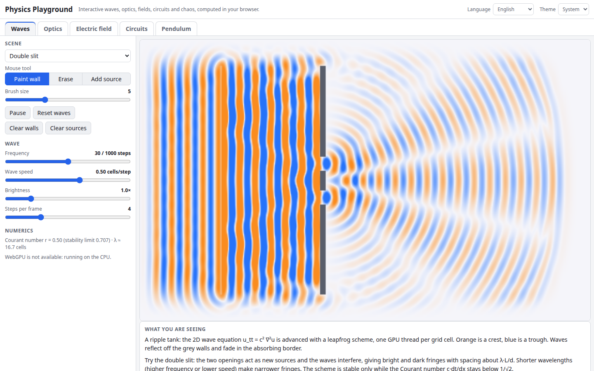

# Physics Playground

Interactive physics you can poke at: a 2D ripple tank solved on a WebGPU compute grid, ray optics with prisms and lenses, electric fields and potentials of draggable charges, RC / RL / RLC circuit transients, and a chaotic double pendulum. Everything runs in your browser. Where WebGPU is not available (older browsers, headless Chrome), the simulations fall back to a CPU canvas renderer automatically.

**Try it: [hermes98761234.github.io/physics-playground](https://hermes98761234.github.io/physics-playground/)**

[](https://github.com/hermes98761234/physics-playground/actions/workflows/deploy.yml)



## Features

- **Ripple tank (WGSL compute).** The 2D wave equation on a 480×300 grid, one GPU thread per cell. Point sources, a plane-wave source with single and double slit presets, a parabolic mirror, walls you paint (and erase) with the mouse, absorbing borders, and frequency and wave-speed controls. The Courant number and stability limit are shown live.
- **Geometric optics.** Draggable and rotatable lenses, mirrors, prisms and glass blocks. Rays follow Snell's law with total internal reflection, and white light is dispersed with Cauchy's equation, so a prism makes a spectrum.
- **Electric field and potential.** Draggable point charges with a GPU-shaded potential map (equipotential lines included) and traced field lines, plus a probe that reads V and |E| under the cursor.
- **Circuit transients.** Series RC, RL and RLC driven through a switch: animated current dots on the schematic and live voltage and current plots. Flip the switch to short the source and watch the discharge.
- **Double pendulum.** RK4 integration with fading trails, a twin pendulum started 0.001 rad away to show chaos, and drag-to-set starting angles.
- **English and Ukrainian, light, dark or system theme.** Settings are remembered in the browser. No backend, no tracking.

## How it works

The physics lives in `src/lib` as pure TypeScript with unit tests:

- `wave.ts`: leapfrog scheme for u_tt = c²∇²u with a quadratic absorbing sponge. The scheme is stable only while the Courant number c·dt/dx ≤ 1/√2 (the 2D CFL condition), which the controls respect and the tests check. `src/gpu/wave.ts` runs the same scheme as a WGSL compute shader over three rotating storage buffers and renders with a fragment shader.
- `optics.ts`: Snell's law (scalar and vector form), critical angle, Cauchy dispersion, and a 2D ray tracer for thin lenses, mirrors and polygonal glass.
- `electro.ts`: potential, field and field-line tracing for softened point charges. The GPU shader evaluates the same sums per pixel.
- `circuit.ts`: RK4 for RC, RL and RLC with exact step responses (under-, critically and over-damped) used as the test reference.
- `pendulum.ts`: double-pendulum equations of motion with RK4 and an energy function; the tests check energy conservation and the small-oscillation normal mode.

If `navigator.gpu` is missing or no adapter is found, the same models run on the CPU and draw to a 2D canvas, so the site still works.

## Quick start

You need [Node.js](https://nodejs.org/) 22.

```bash
git clone https://github.com/hermes98761234/physics-playground.git
cd physics-playground
npm install
npm run dev       # http://localhost:5173
npm test          # numerics and i18n tests
npm run build     # static site in dist/
```

## License

MIT
